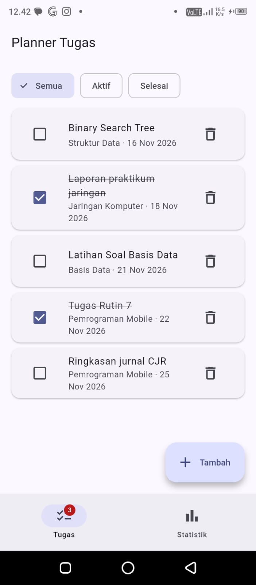
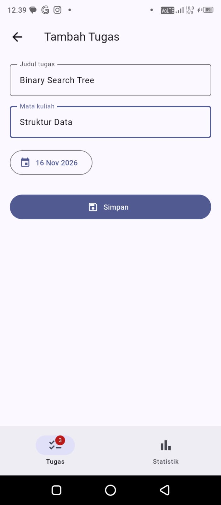
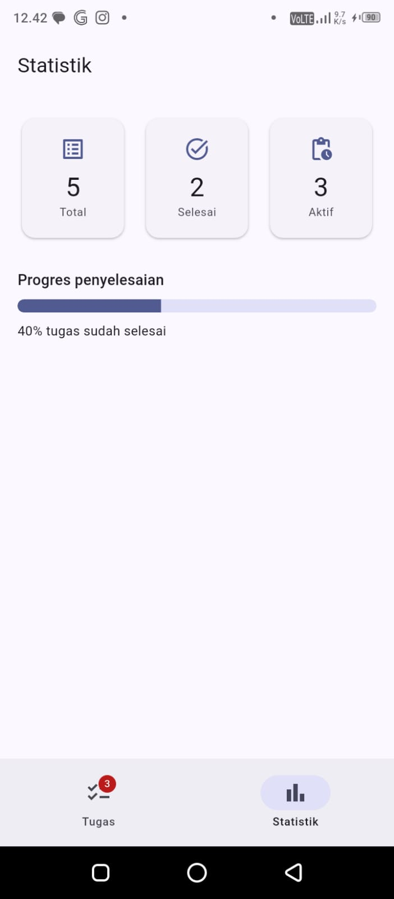
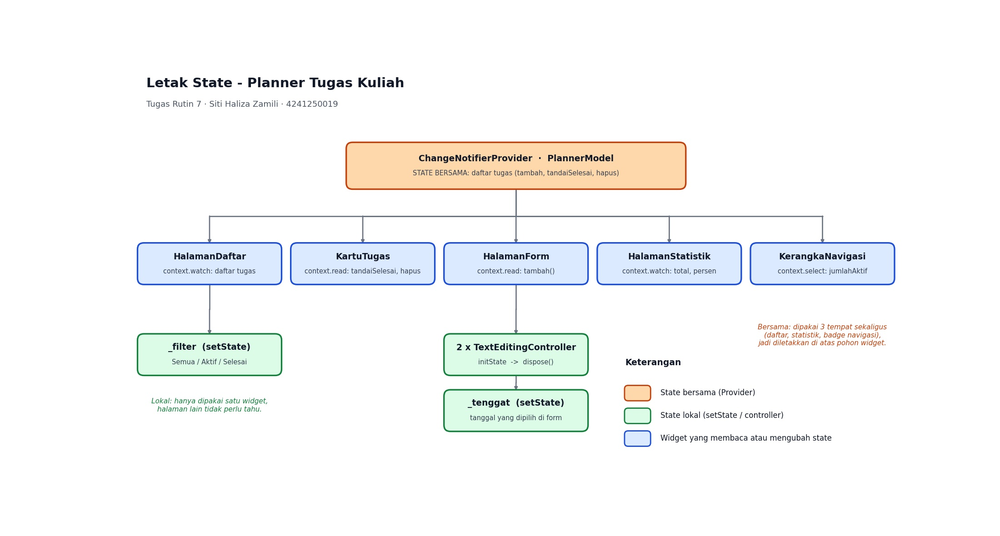

# Tugas Rutin 7 - Planner Tugas Kuliah dengan State Management

**Nama:** Siti Haliza Zamili
**NIM:** 4241250019
**Kelas:** PSIK 24D

## Deskripsi
Aplikasi Flutter pencatat tugas kuliah dengan tiga halaman yang berbagi state: daftar tugas,
form tambah tugas, dan statistik. Data tugas disimpan di satu objek `PlannerModel`
(`ChangeNotifier`) yang disediakan oleh Provider, sehingga daftar, statistik, dan badge pada
navigasi selalu sinkron. Filter Semua/Aktif/Selesai dikelola dengan `setState` karena hanya
dipakai satu halaman. Navigasi memakai go_router dengan kerangka NavigationBar dan
NavigationRail yang berganti menurut lebar layar.

## Struktur Proyek
```
lib/main.dart             -> PlannerApp, router, KerangkaNavigasi (badge dengan select)
lib/planner_model.dart    -> TugasKuliah, FilterTugas, PlannerModel (state bersama)
lib/data_contoh.dart      -> data awal contoh
lib/format.dart           -> format tanggal
lib/halaman_daftar.dart   -> daftar tugas + FilterChip (setState)
lib/halaman_form.dart     -> form tambah tugas (controller di initState/dispose)
lib/halaman_statistik.dart-> statistik otomatis
test/planner_model_test.dart -> unit test logika state (tanpa UI)
screenshots/              -> tangkapan layar dan diagram
```

## Cara Menjalankan
```
flutter pub get
flutter run -d chrome
```
Pengujian dan pemeriksaan kode:
```
flutter test
flutter analyze
```

## Tangkapan Layar
<table>
  <tr>
    <td><br><sub>Halaman daftar dengan filter dan badge</sub></td>
    <td><br><sub>Form tambah tugas</sub></td>
    <td><br><sub>Halaman statistik</sub></td>
  </tr>
</table>

## Diagram Letak State
Oranye adalah state bersama (Provider), hijau adalah state lokal, biru adalah widget yang membaca atau mengubah state.



| State | Jenis | Letak | Alasan |
|---|---|---|---|
| Daftar tugas (`PlannerModel`) | Bersama | `ChangeNotifierProvider` di atas `MaterialApp` | Dipakai halaman daftar, statistik, form, dan badge navigasi, serta harus bertahan saat berpindah halaman |
| Filter Semua/Aktif/Selesai (`_filter`) | Lokal (ephemeral) | `_HalamanDaftarState` | Hanya dipakai halaman daftar, halaman lain tidak perlu tahu |
| Controller judul dan mata kuliah | Lokal | `_HalamanFormState` | Hanya hidup selama form terbuka, dibuat di `initState` dan dibuang di `dispose` |
| Tanggal tenggat (`_tenggat`) | Lokal (ephemeral) | `_HalamanFormState` | Hanya dipakai form sampai tombol Simpan ditekan |

## Penjelasan
Lifecycle StatefulWidget saya pakai di dua tempat. Di `HalamanForm` (`lib/halaman_form.dart`), dua `TextEditingController` untuk judul dan mata kuliah dibuat di `initState()` karena cukup dibuat sekali saat State dibuat, lalu dibuang di `dispose()` supaya tidak terjadi kebocoran memori. Setelah `await showDatePicker`, saya memeriksa `mounted` sebelum memanggil `setState`, karena halaman bisa saja sudah ditutup selama pengguna memilih tanggal. Di `HalamanDaftar`, pilihan filter Semua/Aktif/Selesai disimpan dengan `setState` karena hanya dipakai satu widget dan tidak perlu diketahui halaman lain, sehingga termasuk ephemeral state. Data tugas saya simpan di `PlannerModel` yang disediakan `ChangeNotifierProvider` di atas `MaterialApp`, karena dibutuhkan tiga tempat sekaligus: halaman daftar, halaman statistik, dan badge pada navigasi. Saya memilih Provider daripada Cubit karena skala aplikasi masih kecil, boilerplate Provider lebih sedikit, dan logikanya tetap bisa diuji tanpa UI lewat unit test `PlannerModel`. Pada badge saya memakai `context.select` agar navigasi hanya dibangun ulang saat jumlah tugas aktif berubah, sedangkan tombol di dalam callback memakai `context.read`. Keputusan ini mengikuti prinsip menyimpan state sedekat mungkin dengan pemakainya: state yang dipakai satu widget tetap lokal, sedangkan state yang dipakai banyak halaman diangkat ke atas pohon widget.

## Pernyataan Penggunaan AI
Saya menggunakan Claude (Anthropic) selama mengerjakan tugas ini.

**Dibantu AI:**
- Penjelasan materi Pertemuan 7 (modul dan slide).
- Kode seluruh berkas di folder `lib` dan `test`.
- Gambar diagram letak state, langkah Git, dan kerangka README.
- Draf bagian Penjelasan (saya baca, pahami, dan sesuaikan).

**Saya kerjakan sendiri:**
- Membuat proyek dan repository GitHub, serta melakukan commit dan push.
- Menjalankan aplikasi di Chrome dan di HP Infinix, mencoba tambah, selesai, hapus, dan filter, serta mengambil tangkapan layar.
- Menjalankan `flutter test`, `flutter analyze`, dan `dart format`.
